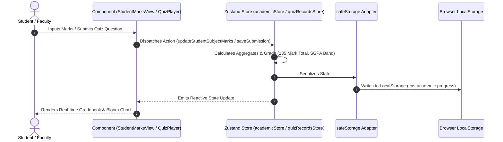
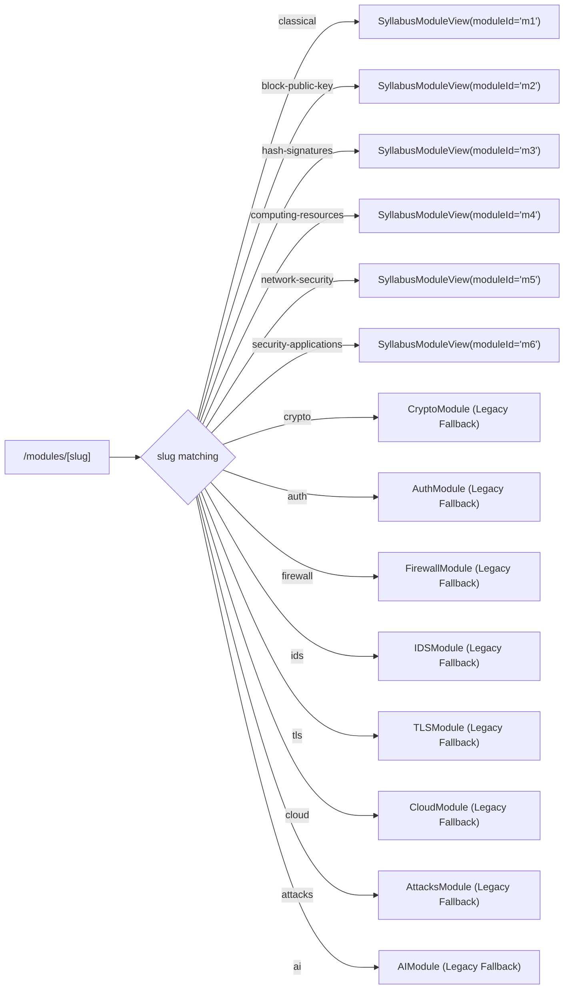

# System Architecture Specification

## 1. Executive Summary

The **TCET LMS Computer Network Security (CNS)** platform is built as an offline-first, client-side progressive web application using Next.js 16 (App Router + Turbopack). It operates without requiring an external database, external API backend, or server-side secret management.

All algorithmic simulators, cryptographic solvers, continuous evaluation marksheets, portion unlock milestones, and quiz grading logic execute deterministically within the user's browser environment using TypeScript and Zustand persistence layers with SSR-safe hydration wrappers.

---

## 2. System Architecture Diagram

```mermaid
flowchart TD
    subgraph ClientBrowser ["Client Browser (Chrome / Edge / Firefox / Safari / Mobile)"]
        subgraph PresentationLayer ["UI & Presentation Layer (React 19 + Tailwind CSS v4)"]
            Navbar["Navbar & Brand Strip"]
            Landing["Landing & 4-Year Matrix (/)"]
            StudentPortal["Student Dashboard (/student)"]
            TeacherPortal["Faculty Gradebook (/teacher)"]
            ModuleShellComp["Module Shell & Guided Lessons (/modules/[slug])"]
            PresenterComp["Fullscreen Presenter Mode (/present/[mod]/[topic])"]
            QuizPlayerComp["Quiz Assessment Engine (/quiz/[mode]/play)"]
            RevisionComp["Exam Revision Hub (/revision)"]
        end

        subgraph StateManagement ["State Management Layer (Zustand)"]
            AuthStore["useAuthStore (Student & Faculty Sessions)"]
            AcademicStore["useAcademicStore (Continuous Evaluation & Milestones)"]
            QuizStore["useQuizRecordsStore (Gradebook & Bloom Analytics)"]
            HydrationWrapper["safeStorage Wrapper (SSR Hydration Mismatch Defense)"]
        end

        subgraph AlgorithmicCore ["Algorithmic Security & Solver Core (src/lib)"]
            CryptoLib["src/lib/crypto (Classical, RSA BigInt, ECC, Hashes, PKI)"]
            SecurityLib["src/lib/security (Bell-LaPadula, Biba, Buffer Overflow, WebAuthn)"]
            NetworkLib["src/lib/network (Stateful Conntrack, SYN Cookies, Packet Dissector)"]
            AuthLib["src/lib/auth (Password Entropy, TOTP RFC 6238)"]
            SyllabusDef["src/lib/syllabus.ts (6 Autonomous Modules Topic Trees)"]
        end

        subgraph StorageLayer ["Client Persistence Layer"]
            LocalStorage[("Browser LocalStorage (cns-auth-session, cns-academic-progress)")]
        end
    end

    PresentationLayer --> StateManagement
    PresentationLayer --> AlgorithmicCore
    StateManagement --> HydrationWrapper
    HydrationWrapper --> LocalStorage
```



---

## 3. Core Architectural Principles

### 3.1 Zero-Backend Client-First Execution
- **Deployment Portability:** The platform compiles to purely static assets via Next.js `generateStaticParams()` (95 static routes). It can be deployed on Vercel, GitHub Pages, or operated completely offline in university computer laboratories without internet connectivity.
- **Deterministic Simulation:** Rather than attempting to spin up dangerous, exploitable virtual machines for attacks, all cryptographic algorithms (e.g. RSA BigInt math, AES MixColumns, Bell-LaPadula access rules, TCP SYN cookies) are modeled mathematically in pure TypeScript.

### 3.2 Hydration Mismatch Immunity
A common vulnerability in client-heavy Next.js applications is rendering content dependent on `localStorage` during initial server/client render passes, causing React hydration mismatches. 

The architecture enforces strict hydration boundaries:
```tsx
// Pattern applied across all persistent stores and components
export function useMounted() {
  const [mounted, setMounted] = useState(false)
  useEffect(() => { setMounted(true) }, [])
  return mounted
}
```
All persistent values are stored through `safeStorage` (which safely falls back to in-memory state during SSR), and root components render a neutral skeleton until `mounted === true`.

---

## 4. Layer Breakdown & File Organization

```text
src/
├── app/                                # Next.js 16 App Router Routes
│   ├── page.tsx                        # TCET LMS Landing & 4-Year Engineering Matrix
│   ├── layout.tsx                      # Root Layout, Token Variables & Global Providers
│   ├── login/page.tsx                  # Dual-Role Authentication (Student / Faculty)
│   ├── student/page.tsx                # Student Portal (Marks Sheet, Timeline, Notes, Quizzes)
│   ├── teacher/page.tsx                # Faculty Gradebook (Marks Upload, Portion Controls)
│   ├── timeline/page.tsx               # Standalone Academic Portion Progress View
│   ├── revision/page.tsx               # Revision Hub (Syllabus Tracker, Cheat Sheets, Formulas)
│   ├── quiz/                           # Quiz Hub & Interactive Runner
│   │   ├── page.tsx                    # Quiz Hub with 6 Syllabus Modules + Mock Exam
│   │   ├── play/page.tsx               # Generic Assessment Runner
│   │   └── [mode]/play/page.tsx        # Mode-specific Assessment (M1–M6, mock, numerical)
│   ├── present/[module]/[topic]/       # Fullscreen Presentation Deck (Hall Projector Mode)
│   └── modules/[slug]/page.tsx         # Unified Module Shell (M1–M6 + 8 Legacy Routes)
│
├── components/
│   ├── academic/
│   │   ├── StudentMarksView.tsx        # Multi-Subject Continuous Evaluation Ledger & CSV Export
│   │   └── AcademicTimelineView.tsx    # Portion Milestone Coverage & Unlock Rule Engine
│   ├── layout/
│   │   ├── Navbar.tsx                  # Global Responsive Navbar with Role Badges & Drawer
│   │   ├── ModuleShell.tsx             # 5-Tab Syllabus Layout (Learn, Try, Cost, Quiz, Recap)
│   │   ├── GuidedLesson.tsx            # Three-Layer Scrollytelling Lesson Component
│   │   └── PresenterMode.tsx           # Fullscreen Lecture Hall Projector Controller
│   ├── quiz/
│   │   └── v2/QuizPlayer.tsx           # Ink-Stamp Assessment Engine & Bloom Analytics
│   └── ui/                             # "Lab Notebook" Themed Atomic UI (Card, Button, Tabs)
│
└── lib/                                # Pure Algorithmic Libraries (Zero DOM / UI Code)
    ├── academicStore.ts                # Continuous Evaluation (135 Marks) & Milestone Store
    ├── authStore.ts                    # Student & Faculty Profiles, Credentials & Roles
    ├── quizRecordsStore.ts             # Assessment Submissions Ledger & Historical Metrics
    ├── syllabus.ts                     # TCET 6-Module Syllabus Definitions, Hours, & Bloom Levels
    ├── crypto/                         # Classical Ciphers, DES, AES, RSA, ECC, Hashes, PKI
    ├── security/                       # Bell-LaPadula, Biba, Buffer Overflow, WebAuthn, ZTA
    ├── network/                        # 5-Tuple ACL, Stateful Conntrack, RFC 4987 SYN Cookies
    └── auth/                           # Password Entropy, Dictionary Matching, TOTP RFC 6238
```

---

## 5. State Management & Data Flow



### 5.1 Storage Keys & Schemas

| Storage Key | Associated Store | Primary Payload |
|---|---|---|
| `cns-auth-session` | `useAuthStore` | Current active role (`student` \| `teacher`), credentials, candidate roll number, and department. |
| `cns-academic-progress` | `useAcademicStore` | Continuous evaluation mark ledger (ISE 1 [20], FA 1 [25], ISE 2 [20], ISE 3 [20], FA 2 [25], Term Work [25] = 135) and portion unlock milestones across modules M1–M6. |
| `cns-quiz-records-v2` | `useQuizRecordsStore` | Completed quiz attempts, question IDs, timestamps, accuracy %, and Bloom level score distribution. |

---

## 6. Routing & Module Resolution Architecture

The application supports both the **6 University Syllabus Modules** and **8 Legacy Modules** to ensure backwards compatibility with zero dead links:



---

## 7. Mobile Optimization Architecture

To ensure high usability on mobile viewports (360px–414px):
1. **Horizontal Touch-Scroll Pill Containers:** Tab bars with high item counts (e.g. 18 tabs in Cryptography, 4 tabs in Portals) use `overflow-x-auto pb-2 scrollbar-none` combined with `shrink-0 whitespace-nowrap` pills to eliminate stacked vertical clutter.
2. **Dynamic Button Reachability:** Primary evaluation buttons (*Confirm & Reveal Answer*, *Next Question*) adapt from `w-auto` on desktop to `w-full` on mobile screens for comfortable single-thumb reach.
3. **Table Horizontal Scroll Affordances:** Wide ledger tables in `StudentMarksView` feature explicit visual cues (`← Swipe table horizontally →`) and reduced padding (`p-4 sm:p-6`).

---

## 8. Quality Assurance & Test Architecture

The codebase incorporates a dual-tier testing pipeline:
1. **Vitest Unit Solvers (125 tests):** Validates deterministic math for classical ciphers, RSA modular exponentiation, Diffie-Hellman MITM exchanges, ECC curve addition, HMAC SHA-256 padding, Bell-LaPadula vs Biba, and RFC 4987 SYN cookie generation.
2. **Playwright E2E Suite (58 tests):** Executes browser automation across Chromium, verifying navigation immunity from console errors, mobile 360px screen compatibility, keyboard presenter hotkeys, and full assessment quiz runs.
